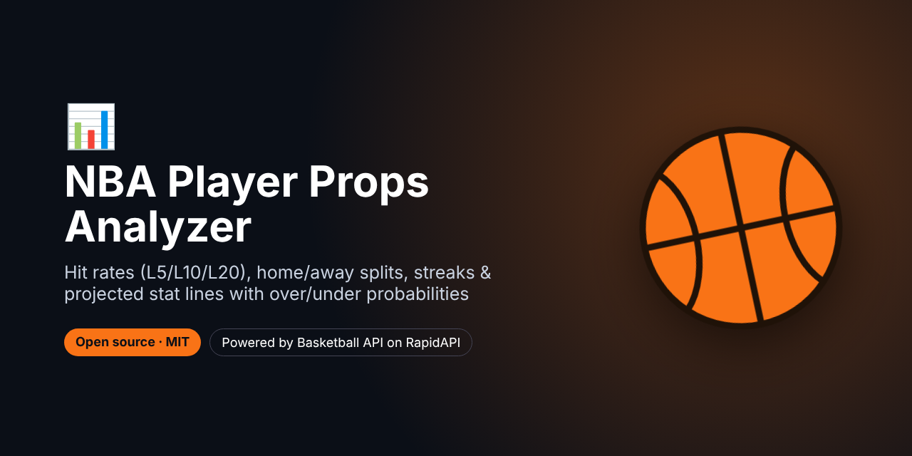
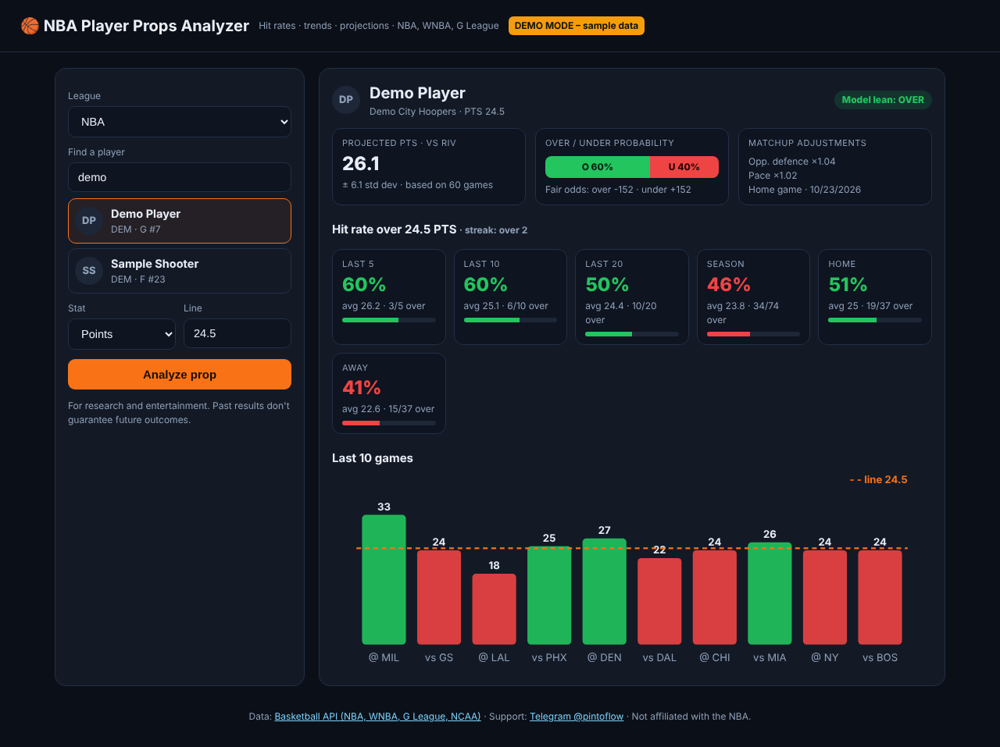
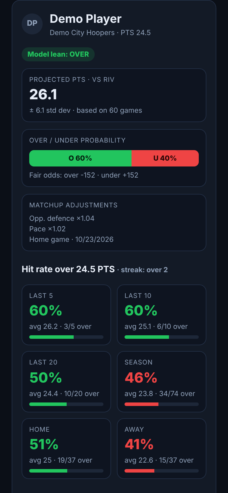

# NBA Player Props Analyzer – Hit Rates, Trends & Projections



> **For faster support reply, contact us on Telegram: [@pintoflow](https://t.me/pintoflow)**

A free, self-hosted **NBA player props research tool**. Pick a player, a stat and a line (for example *Points over 24.5*) and see:

- **Hit rates** over the line for the **last 5, 10 and 20 games**, the **season**, **home** and **away**
- the current **over/under streak** and a **last-10-games chart** against the line
- a **projected stat line for the next game**, adjusted for the opponent's defence, pace and home/away
- **over/under probabilities**, the model's **lean** and **fair odds**

It works for the **NBA, WNBA and G League**. It's Node.js with **zero dependencies**.

Powered by the **[Basketball API (NBA, WNBA, G League, NCAA)](https://rapidapi.com/belchiorarkad-FqvHs2EDOtP/api/api-basketball-nba)** on RapidAPI.





<sub>Screenshots in demo mode with sample data (fictional player).</sub>

---

## Why this exists

Prop bettors and fantasy players search every day for "NBA player prop hit rates", "player props trends" and "NBA prop projections". Paid apps and Chrome extensions sell exactly this. This open-source version runs on your own server with your own API key.

## Features

- 🔎 Player search (accents don't matter: `doncic` finds Dončić)
- 📊 13 stats: PTS, REB, AST, 3PM, PRA, PR, PA, RA, STL, BLK, STOCKS, TO and fantasy points
- ✅ Hit rate cards for L5, L10, L20, season, home and away
- 📈 Last-10 bar chart against your line
- 🔮 Next-game projection with standard deviation, over/under probability, lean and fair odds
- 🏀 NBA, WNBA and G League
- 🔒 Your RapidAPI key stays on the server. Responses are cached using the API's own `cacheTtlSeconds`.
- 🧪 **Demo mode** with sample data, so you can try it without a key

## Quick start

```bash
git clone https://github.com/BelNaruto/nba-player-props-analyzer.git
cd nba-player-props-analyzer

node server.js                                 # demo mode
RAPIDAPI_KEY=your_rapidapi_key node server.js  # live data
```

Open **http://localhost:3000**. Requires Node.js 18 or newer, and there's nothing to install.

Get a key: **https://rapidapi.com/belchiorarkad-FqvHs2EDOtP/api/api-basketball-nba**

## API endpoints used

| Endpoint | Used for |
|---|---|
| `GET /v2/players/search?q=curry` | Find a player's ID |
| `GET /v2/players/{playerId}/trends?stat=PTS&line=24.5` | Averages and over rates for L5/L10/L20/season/home/away, streak, last 10 games |
| `GET /v2/players/{playerId}/projection?lines=PTS:24.5` | Projected stat line for the next game with over/under probabilities and fair odds |

Add `league=wnba` or `league=gleague` to any call for other leagues.

## Deploy

One Node.js file and one HTML file. Deploy to **Google Cloud Run, Render, Railway, Fly.io** or any VPS with the start command `node server.js` and the env var `RAPIDAPI_KEY`.

## Related projects

- 🔮 [NBA Predictions Dashboard](https://github.com/BelNaruto/nba-predictions-dashboard): win probabilities, projected scores, title odds
- 🔔 [NBA Live Scores Bot](https://github.com/BelNaruto/nba-live-scores-bot): Discord and Telegram previews, live scores and finals
- 📘 [Basketball API docs and examples](https://github.com/BelNaruto/basketball-api-nba)

## Support

> **For faster support reply, contact us on Telegram: [@pintoflow](https://t.me/pintoflow)**

API: https://rapidapi.com/belchiorarkad-FqvHs2EDOtP/api/api-basketball-nba

---

MIT License. For research and entertainment; this is not betting advice. Not affiliated with the NBA, WNBA or any sportsbook.

**Keywords:** nba player props, nba prop hit rates, player prop trends, nba prop projections, nba props tool, over under, prop betting research, fantasy basketball, wnba props, basketball api
